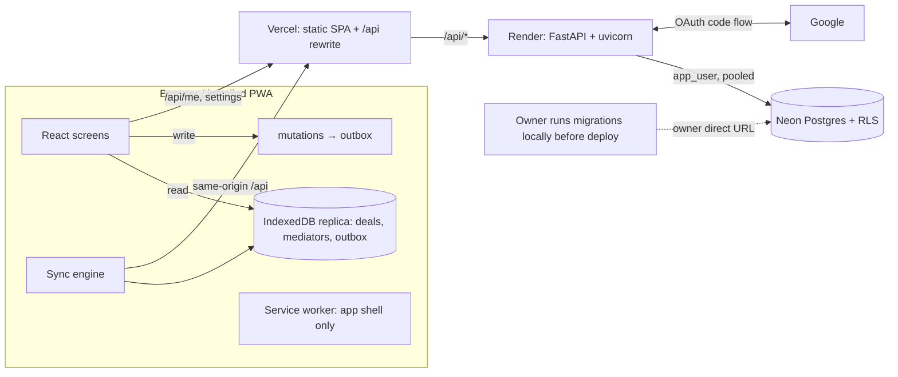

# ARCHITECTURE

**TL;DR**
- Two deployables: FastAPI API (Render) and a static React PWA (Vercel). Vercel rewrites `/api/*` to the API so the browser sees one origin.
- Postgres (Neon) enforces per-user isolation with row-level security; the app connects as `app_user` which cannot bypass it.
- Each request runs in one transaction that sets `app.current_user_id` (transaction-local) from the server-side session.
- The UI is offline-first: it reads an IndexedDB replica and writes to an outbox; a sync engine pushes ops and pulls changes.
- Conflicts: last-write-wins per record on the writer's clock; idempotency by `op_id` and `client_id`.
- Free tiers shape the design: cold starts (~1 min) are treated as normal, never as failures.
- Details of files/APIs/schema: [IMPLEMENTATION.md](IMPLEMENTATION.md). Rules for contributors: [AGENTS.md](../AGENTS.md).

## System overview


| Component | Responsibility |
|---|---|
| `frontend/` PWA | screens, local replica, outbox, sync, install prompts; never caches `/api` |
| Vercel | serves `dist/`, SPA fallback, CSP headers, rewrites `/api/*` → Render |
| FastAPI | auth, sessions, validation, business rules, repos, sync protocol |
| Postgres | data, constraints, RLS isolation, `updated_at` triggers |

Migrations run from the operator's computer with the owner direct URL before deploying an application release that requires them. The owner URL is used only by local migration tooling and must never be configured in Render; the API container starts without running Alembic.

## Auth and session flow
1. Login button navigates to `/api/auth/google/login?next=/path` (relative paths only).
2. API stores state + nonce + next in a 10-minute signed cookie `dt_oauth` (path `/api/auth`) and redirects to Google.
3. Google redirects to `FRONTEND_URL/api/auth/google/callback` — **the frontend origin**, forwarded by Vercel (or the Vite proxy locally).
4. API validates state, exchanges the code, verifies the ID token + nonce, requires `email_verified`, upserts the user by `google_sub`, creates a session (32 random bytes; only SHA-256 stored) and sets `dt_session` (HttpOnly, Secure in prod, SameSite=Lax, 30-day sliding).
5. `current_user` resolves the cookie on every private request; `last_seen_at`/expiry refresh at most every 10 minutes.

**Why the rewrite:** cookies are first-party on the Vercel domain. Safari (ITP) blocks third-party cookies, and same-origin also removes CORS and makes the CSRF header check sufficient.

## Isolation model
- `app_user`: LOGIN, NOSUPERUSER, NOBYPASSRLS, DML only. On Neon the owner role has BYPASSRLS, so it is used **only** for migrations.
- Per-user tables (`deals`, `mediators`, `sync_ops`, `import_jobs`): ENABLE + FORCE RLS, policy `user_id = NULLIF(current_setting('app.current_user_id', true), '')::uuid` for USING and WITH CHECK. Missing setting → zero rows, writes rejected.
- `get_user_db` opens one transaction and runs `set_config('app.current_user_id', uid, true)`; `true` = transaction-local, so it is safe through PgBouncer (Neon pooled) and never leaks to the next request.
- Repos also filter by the same setting and set `user_id` from it (defence in depth; never from input).
- `users`, `sessions` are not under RLS: they must be read before a user context exists (cookie lookup, login upsert). Only `app/auth/` touches them.
- FK checks bypass RLS, so deals reference mediators via composite FK `(mediator_id, user_id)` → a deal can only point at its owner's mediator.

## Offline-first sync protocol
- **Local first:** every create/edit/action/delete updates IndexedDB, then appends an outbox op `{op_id, type, op, id, client_id, data, client_updated_at}`. The UI never waits.
- **Ids:** the device generates UUIDs; new deals use the same value for `id` and `client_id`. A colliding id from another account fails the insert (`id_conflict`) and never overwrites.
- **Engine triggers:** app start, `online`, tab visible, 800 ms after a write, every 60 s while visible. One cycle = push outbox in order (batches ≤ 100) → pull.
- **Push results:** `applied`/`duplicate` → op removed. `rejected` with `stale:`/`deleted:` → server wins, op removed, full re-pull. Other `rejected` → op kept as "needs attention" with the reason (Fix or Discard in the UI). Network errors/timeouts never change an op.
- **Idempotency:** applied `op_id`s are stored in `sync_ops`; repeats return `duplicate`. `POST /api/deals` with an existing `client_id` returns the existing deal (200).
- **Pull:** `GET /api/sync/changes?since=<time>&cursor=<page>&limit=<1..500>` returns stable pages, ordered by update time and record id. The overlap covers transactions that committed late; the client applies all pages, skipping records with unsynced local ops, before saving `server_time`. Empty `since` = paginated full snapshot.
- **Superseded edits:** when a pull returns a newer server version over a pending local edit, the UI keeps the server copy and shows a notice linked to that deal.
- **Conflict policy:** last-write-wins per record using `client_updated_at` (device clock, corrected by the server-time offset learned on each pull) compared to the record's last accepted write time. **Limitation:** concurrent edits of the same record on two devices — the later writer overwrites the earlier one entirely for the fields it sent; large clock errors can mis-order writes.
- **Cold start:** request timeout 70 s; chip shows "Waking server…" after 4 s; exponential backoff 2 s → 60 s.
- **Account safety:** the local DB records its owner; a different user → wipe. Logout and account deletion wipe IndexedDB and app localStorage keys.
- **Legacy money upgrade:** Dexie v2 converts existing deal records and queued upsert operations from legacy `refund_amount` to Less/Commission before the outbox syncs. Server `op_id` idempotency is unchanged.
- **Deal numbering:** the client numbers the complete active local list by `date_taken`, `created_at`, then `id`; filtered views retain those ranks, so numbering works offline. Deleting a deal or changing its date can shift later numbers.

## Data model
For deals, `amount_paid` is P, `less_amount` is L, and `commission` is C. Constraints enforce `0 ≤ L ≤ P` and `C ≥ 0`; generated `refund_amount` is the net refund `P - L + C`. `net_amount` is the gain/loss `C - L`. All four monetary values use `numeric(12,2)` in Postgres and decimal strings in JSON; frontend calculations use integer paise. Migration 0004 preserves prior total money back during its backfill by adding old commission to the converted commission. Its downgrade keeps the previous total semantics but loses the separate Less/Commission split.

```mermaid
erDiagram
  users ||--o{ sessions : has
  users ||--o{ mediators : owns
  users ||--o{ deals : owns
  users ||--o{ sync_ops : owns
  users ||--o{ import_jobs : owns
  import_jobs ||--o{ deals : imports
  mediators ||--o{ deals : "(mediator_id,user_id)"
  users { uuid id PK; text google_sub UK; text email; text role; smallint alert_days; text timezone }
  sessions { uuid id PK; uuid user_id FK; text token_hash UK; timestamptz expires_at }
  mediators { uuid id PK; uuid user_id FK; text name; timestamptz updated_at; timestamptz deleted_at }
  deals { uuid id PK; uuid user_id FK; uuid client_id; uuid mediator_id; uuid import_job_id FK; text mediator_name; date date_taken; numeric amount_paid; numeric less_amount; numeric commission; numeric refund_amount; date review_deadline; date refund_form_deadline; text review_status; text form_status; text payment_status; timestamptz created_at; timestamptz updated_at; timestamptz deleted_at }
  sync_ops { uuid user_id PK; uuid op_id PK; uuid record_id }
  import_jobs { uuid id PK; uuid user_id FK; uuid import_id; text status; int rows_imported; numeric total_paid; numeric total_refund; jsonb errors; timestamptz created_at; timestamptz undone_at }
```

## Spreadsheet import
- The browser parses `.xlsx`, `.xls`, and `.csv` in a Web Worker with SheetJS CE 0.20.3, pinned from the official SheetJS distribution. The file stays on the device; only mapped cell values and import options go to the API. The parser handles workbook formats and keeps large parsing work off the UI thread.
- The user selects a sheet and header row, maps columns, sets date order and status mappings, and previews the server's normalized values, validation errors, duplicates, and reconciliation totals. Preview does not write data. Mapping preferences are stored per user and header set.
- Less is mapped from `less`, `deduction`, `discount`, `cut`, or `mediator less`. A mapped legacy Refund without Less is converted per row into Less and Commission and the derivation is shown in preview; explicit Less wins and a mismatch with mapped Refund is warned. Existing-deal matches include the server deal ID so the client can display its offline number.
- Commit sends online batches of at most 500 rows. The server normalizes and validates again, detects existing and within-file duplicates, and uses a per-user import ID plus deterministic row client IDs for retry-safe writes. Each batch returns counts and amount totals; the `import_jobs` record provides history and an error CSV.
- `import_jobs` has FORCE RLS. Deals reference jobs through `(import_job_id,user_id)`, so a job cannot be attached across users. Undo within 30 days soft-deletes unchanged imported deals, removes mediators created by that import only when now orphaned, and reports rows that changed since import.

## Security model
Session cookie (opaque, hashed at rest) · CSRF header on mutations · CSP/X-Frame-Options/nosniff/Referrer-Policy (API + Vercel) · HSTS in prod · open-redirect-safe `next` · auth limits (20/min per IP), authenticated limits (120/min per user), import (30 previews/hour, 10 commits/hour), and sync push (30/min per user) · strict schemas (`extra="forbid"`, floats rejected) · logs without query strings, tokens or emails · no CORS.

## Deployment topology and free-tier constraints
- Render free web service (Docker): sleeps after 15 min idle, ~1 min to wake; runs `alembic upgrade head` (owner URL) then uvicorn. A keep-alive pinger on `/api/health` (no DB) avoids sleeps but uses free instance hours.
- Neon free: compute auto-suspends (first query after idle is slower), limited storage/compute hours; use the pooled endpoint at runtime and the direct endpoint for migrations.
- Vercel free: static hosting + rewrites.

## Decisions
| Decision | Context | Choice | Rejected | Consequence |
|---|---|---|---|---|
| Isolation in DB | shared app, top requirement | RLS + `app_user` | app-only filtering | a missed filter cannot leak data |
| Transaction-local context | Neon pooling | `set_config(…, true)` per txn | session-level `SET` | safe with PgBouncer |
| Same-origin API | Safari ITP | Vercel rewrite | CORS + third-party cookies | one origin, simple CSRF |
| Opaque sessions | revocable, small cookie | DB sessions, SHA-256 | JWT | logout/delete is immediate |
| Offline-first | patchy mobile data | Dexie replica + outbox | online-only + cache | instant UI, sync complexity |
| LWW per record | simple, few devices per user | writer clock + offset | CRDT/field merge | concurrent edits overwrite |
| Client-generated ids | offline creates | UUID v4 | server ids + mapping | no remap needed; collisions rejected |
| Money as strings/paise | exactness | numeric + strings | floats | no rounding errors |
| Text + CHECK | easy migrations | CHECK constraints | Postgres enums | add values with a simple migration |
| Spreadsheet parsing | `.xlsx`, `.xls`, `.csv` in browser | SheetJS CE 0.20.3 in a Web Worker from the official distribution | server upload/parsing | local file stays on-device; worker keeps parsing off the UI thread |

## Known limitations
- **Rate limits are per instance and reset on restart.** Auth endpoints alone use the IP address supplied through trusted forwarded headers; the API currently trusts forwarded headers from any peer. Verify the Vercel rewrite → Render forwarding chain and direct-origin access after deployment before relying on IP-based auth limits. Authenticated general, import, and sync-push limits key on the server-resolved user ID.
- LWW limits above; settings and logout need a connection. `sync_ops` cleanup runs opportunistically on pushes (at most 500 rows older than 30 days), so quiet accounts can retain old rows.
- Real Neon, Google OAuth, Render, and Vercel integrations are **NOT VERIFIED HERE**.
